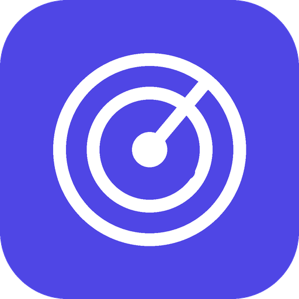
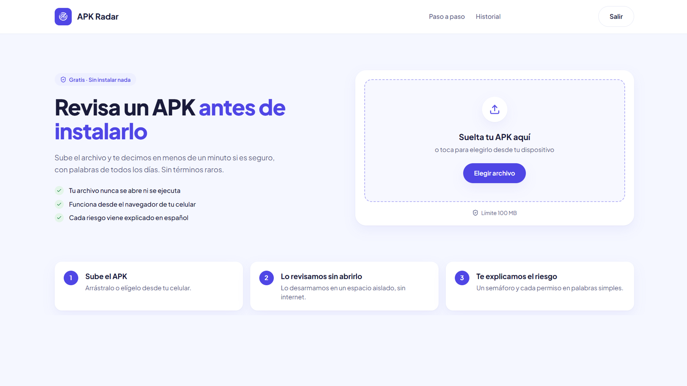

<p align="center"></p>

# APK Radar · Frontend (`fakeapp-radar-web`)

Interfaz web de **APK Radar**: se sube un archivo APK de Android y la página explica, en español sencillo y con un semáforo de riesgo, qué permisos pide la app y por qué podrían ser peligrosos. El archivo **nunca se ejecuta**; solo se analiza de forma estática.



Proyecto final de Seguridad Informática · Universidad Politécnica de Chiapas · Ingeniería en Tecnologías de la Información e Innovación Digital.

## Qué hace
- Subir un APK (hasta 100 MB) arrastrándolo o eligiéndolo desde el dispositivo.
- Mostrar el progreso del análisis y el resultado con puntaje de 0 a 100 (bajo 0–29, medio 30–59, alto 60–100).
- Explicar cada permiso en palabras de todos los días y sugerir qué hacer.
- Registro, inicio de sesión e historial de análisis por usuario.
- Pantalla "Paso a paso" con la explicación del flujo.

## Tecnologías
Next.js · React · TypeScript · Tailwind CSS · Framer Motion · Docker (imagen `standalone`).

## Estructura
| Carpeta | Contenido |
|---|---|
| `fakeapp/` | Proyecto Next.js (código en `src/app` y `src/features`) |
| `fakeapp/security/` | Reglas y reporte de Semgrep (análisis estático del código) |
| `fakeapp/Dockerfile` | Imagen de producción |

## Correr en desarrollo
Requisitos: Node.js 20 o superior y la API corriendo (repo `fakeapp-radar-api`).

```bash
cd fakeapp
cp .env.example .env.local
npm install
npm run dev
```
Abrir http://localhost:3000.

## Seguridad aplicada
- El token de acceso vive en memoria; la sesión se renueva con una cookie `HttpOnly`.
- Sin `dangerouslySetInnerHTML`, `eval` ni claves en el código del front.
- Cabeceras HTTP de seguridad (HSTS, `X-Content-Type-Options`, `X-Frame-Options`, `Referrer-Policy`) desde el proxy.
- Código revisado con Semgrep (`fakeapp/security`).

## Repositorios relacionados
- API: https://github.com/Miteek2000/fakeapp-radar-api
- Base de datos: https://github.com/Miteek2000/fakeapp-radar-db

## Demo
https://3-212-252-49.sslip.io (disponible solo mientras el laboratorio de AWS esté encendido).

## Licencia
MIT. Ver [LICENSE](LICENSE).
